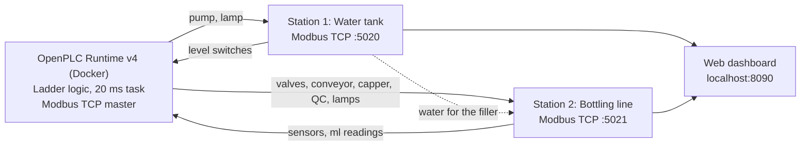

# Water Tank & Bottling Plant: OpenPLC Ladder Logic with Python Process Simulators


This repository holds two connected industrial automation projects. Both are written in **ladder logic** for **OpenPLC Runtime v4**. Each one controls a virtual plant: a Python program that acts as **Modbus TCP remote I/O**, just like real field devices.

| Stage | Project | What it controls |
|---|---|---|
| **1** | **Water Tank Control** | A 20 L storage tank with a supply pump and LOW / HIGH float switches |
| **2** | **Bottling Plant** | The same water tank **plus** a complete bottling line that draws its water from the tank |

The bottling line fills, caps and inspects bottles. A diverter gate sends good bottles to a crate and bad bottles to a reject bin. The filler takes water out of the tank, so the two stations depend on each other, as they would in a real plant.

---

## Highlights

- **Real remote I/O architecture.** OpenPLC is the Modbus TCP master and polls the simulators as remote devices. The simulators only act and measure; the PLC program makes every decision.
- **Two-station plant.** A single PLC program controls two remote I/O stations (tank and line) on separate Modbus ports.
- **Level control with hysteresis.** The pump starts below 20 % and stops at 85 %.
- **Two-speed filling.** A fast valve fills up to 650 ml, then a slow valve tops up to the 700 ml target for accuracy.
- **Quality control.** A camera and check-weigher reject underfilled, overfilled, damaged or uncapped bottles (accepted range 690–710 ml).
- **Counters and interlocks.** A crate counter (12) and a reject-bin counter (10) use CTU blocks. Filling is interlocked with the tank level.
- **Fault handling.** Jam detection (conveyor running for more than 8 s) and a fill timeout, a latched fault with ALARM RESET, an E-stop and a three-colour stack light.
- **Built-in scoring.** The simulator knows the truth about every bottle, so it counts PLC mistakes: bad bottles shipped and good bottles rejected.
- **Fault injection.** From the web page you can trigger a conveyor jam, a clogged nozzle, a supply pump failure, an empty cap feeder, and cracked or dented bottles.

---

## System Architecture



| Simulator | Used by | Modbus ports | User interface |
|---|---|---|---|
| `TankSimulator/tank_sim.py` | Stage 1, Water Tank | `5020` | Desktop window (tkinter) |
| `PlantSimulator/plant_server.py` | Stage 2, Bottling Plant | `5020` (tank) + `5021` (line) | Web page at **http://localhost:8090** |

> Both simulators use port **5020** for the tank, so run only one of them at a time. OpenPLC also runs one program at a time: upload either **WaterTank** or **BottlingPlant**.

---

## Repository Structure

```
├── WaterTank/                        Stage 1: OpenPLC Editor project
│   ├── project.json
│   ├── devices/remote/TankIO.json      Modbus master → tank (5020)
│   └── pous/programs/main.ld           Ladder program (3 rungs)
├── TankSimulator/                    Stage 1: virtual tank
│   ├── tank_sim.py                     Tank physics, Modbus TCP server, tkinter window
│   └── Start Tank.bat
├── BottlingPlant/                    Stage 2: OpenPLC Editor project
│   ├── project.json
│   ├── devices/remote/TankIO.json      Modbus master → tank (5020)
│   ├── devices/remote/BottleIO.json    Modbus master → bottling line (5021)
│   └── pous/programs/main.ld           Ladder program (37 rungs)
└── PlantSimulator/                   Stage 2: virtual tank + bottling line
    ├── plant_io.py                     Modbus TCP stations and I/O lists
    ├── plant_server.py                 Plant physics, faults, scoring, HTTP API
    ├── plant_view.html                 Live web dashboard (SVG mimic)
    └── Start Plant.bat
```

---

## Requirements

- Windows 10/11
- [Python 3.10+](https://www.python.org/). No extra packages are needed (standard library only).
- [Docker Desktop](https://www.docker.com/products/docker-desktop/)
- [OpenPLC Editor 4.3.3 or newer](https://autonomylogic.com/) with OpenPLC Runtime v4. Runtime v4.3.x refuses uploads from older editors.

> **Tip:** Keep the projects in a plain path such as `C:\PLC Project\`. Paths with non-ASCII characters or inside OneDrive can break the OpenPLC build.

---

## Getting Started

### 1. Start OpenPLC Runtime (Docker)

On first use, create the container:

```bash
docker run -d --name openplc-runtime -p 8443:8443 --cap-add=SYS_NICE --cap-add=SYS_RESOURCE -v openplc-runtime-data:/var/run/runtime ghcr.io/autonomy-logic/openplc-runtime:latest
```

After that, start it with:

```bash
docker start openplc-runtime
```

The first time you connect, OpenPLC Editor asks you to create a runtime user.

### 2a. Stage 1: Water Tank

1. Double-click **`TankSimulator/Start Tank.bat`**, or run `python tank_sim.py`. The tank window opens.
2. Open the **`WaterTank`** folder in OpenPLC Editor → **Build & Upload** → **Play**.
3. The **PLC link** lamp in the tank window turns green.
4. Press **START**. The pump fills the tank to 85 % and restarts when the level falls below 20 %. Use the outflow valve slider to drain the tank.

### 2b. Stage 2: Bottling Plant

1. Close the tank window if it is open, because it uses the same port.
2. Double-click **`PlantSimulator/Start Plant.bat`**, or run `python plant_server.py`. The dashboard opens at **http://localhost:8090**.
3. Open the **`BottlingPlant`** folder in OpenPLC Editor → **Build & Upload** → **Play**.
4. On the dashboard, press **START** in the *Water tank* panel, then **START** in the *Bottling line* panel.

> The remote devices point to `host.docker.internal` because the runtime runs inside Docker. If you run OpenPLC natively, change the host to `127.0.0.1`.

---

## How It Works

### Stage 1: Water tank control

| Rung | Logic | Purpose |
|---|---|---|
| 1 | `SYSTEM_ON = (START_BUTTON OR SYSTEM_ON) AND NOT STOP_BUTTON` | Start/stop latch |
| 2 | `PUMP = SYSTEM_ON AND (NOT LOW_LEVEL OR PUMP) AND NOT HIGH_LEVEL` | Pump with hysteresis (on below 20 %, off at 85 %) |
| 3 | `FULL_LAMP = HIGH_LEVEL` | Tank-full indicator |

### Stage 2: Bottling line cycle

The line handles **one bottle at a time**:

```
Feeder → Filler → Capper → QC camera + check-weigher → Diverter → Crate / Reject bin
```

| Step | Station | PLC behaviour |
|---|---|---|
| 1 | **Feeder** | When the line is `READY`, `BUSY` latches and `BOTTLE_RELEASE` pulses for 0.5 s to release one bottle |
| 2 | **Conveyor** | Runs while a bottle is travelling and stops at each station until that station's job is done |
| 3 | **Filler** | `FILL_FAST` (100 ml/s) until `TARGET_ML − 50`, and `FILL_SLOW` (20 ml/s) until `TARGET_ML`. It fills only when the tank is above `LOW_LEVEL`. 20 s timeout |
| 4 | **Capper** | `CAPPER` presses the cap for 1 s |
| 5 | **QC** | `QC_SCAN` triggers the camera. `QC_FAIL` = damage, no cap, underfill (< 690 ml) or overfill (> 710 ml) |
| 6 | **Diverter** | Opens for a bad bottle, which goes to the reject bin. Good bottles go to the crate |
| 7 | **Collect** | The photo-eye pulse ends the cycle (`BUSY` resets). CTU counters count crate (12) and bin (10) |

The tolerances follow `TARGET_ML` automatically: `FAST_LIMIT = TARGET − 50`, `MIN_ML = TARGET − 10` and `MAX_ML = TARGET + 10`.

### Interlocks, faults and stack light

| Condition | Effect |
|---|---|
| E-stop pressed (`ESTOP_OK` = 0) | Line stops, red lamp |
| Conveyor runs for 8 s without stopping (`JAM`) | `FAULT` latches and the line stops until **ALARM RESET** |
| Tank below 20 % | Filler waits (amber lamp) |
| No crate, crate full or reject bin full | No new bottle is released (amber lamp) |

| Lamp | Meaning |
|---|---|
| 🟢 Green | Line running |
| 🟠 Amber | Running but waiting: tank low, crate missing or full, or reject bin full |
| 🔴 Red | Fault or E-stop |

---

## I/O Map

### Station 1: Water tank (`TankIO`, port 5020)

| Address | Signal | Direction | Description |
|---|---|---|---|
| `%IX0.0` | TANK_START / START_BUTTON | Sim → PLC | Start push button |
| `%IX0.1` | TANK_STOP / STOP_BUTTON | Sim → PLC | Stop push button |
| `%IX0.2` | LOW_LEVEL | Sim → PLC | TRUE at or above 20 % |
| `%IX0.3` | HIGH_LEVEL | Sim → PLC | TRUE at or above 85 % |
| `%QX0.0` | PUMP | PLC → Sim | Supply pump |
| `%QX0.1` | FULL_LAMP | PLC → Sim | Tank full lamp |

Modbus groups: FC2 discrete inputs (offset 0, length 4) and FC15 coils (offset 0, length 2). `tank_sim.py` also provides the tank level as input register 0, in steps of 0.1 %.

### Station 2: Bottling line (`BottleIO`, port 5021)

**Discrete inputs (FC2, offset 0, length 13)**

| Address | Signal | Address | Signal |
|---|---|---|---|
| `%IX0.4` | LINE_START | `%IX1.3` | QC_DONE |
| `%IX0.5` | LINE_STOP | `%IX1.4` | QC_DAMAGE |
| `%IX0.6` | ESTOP_OK (normally closed) | `%IX1.5` | QC_NO_CAP |
| `%IX0.7` | ALARM_RESET | `%IX1.6` | BOTTLE_IN_CRATE (0.5 s pulse) |
| `%IX1.0` | BOTTLE_AT_FILLER | `%IX1.7` | BOTTLE_IN_REJECT (0.5 s pulse) |
| `%IX1.1` | BOTTLE_AT_CAPPER | `%IX2.0` | CRATE_PRESENT |
| `%IX1.2` | BOTTLE_AT_QC | | |

**Input registers (FC4, offset 0, length 3)**

| Address | Signal | Description |
|---|---|---|
| `%IW0` | FILLER_ML | Volume in the bottle under the filler (ml) |
| `%IW1` | QC_ML | Check-weigher reading at QC (ml) |
| `%IW2` | TARGET_ML | Fill target set on the dashboard (default 700 ml) |

**Coils (FC15, offset 0, length 10)**

| Address | Signal | Address | Signal |
|---|---|---|---|
| `%QX0.2` | BOTTLE_RELEASE | `%QX0.7` | QC_SCAN |
| `%QX0.3` | CONVEYOR | `%QX1.0` | DIVERTER |
| `%QX0.4` | FILL_FAST | `%QX1.1` | GREEN_LAMP |
| `%QX0.5` | FILL_SLOW | `%QX1.2` | AMBER_LAMP |
| `%QX0.6` | CAPPER | `%QX1.3` | RED_LAMP |

---

## Simulators

### Water tank window (`tank_sim.py`)

- START / STOP push buttons, an outflow valve slider (0–100 %), and **Drain to 10 %** / **Reset to 50 %** buttons
- Live pump, float switch and PLC link indicators
- Pump adds 4 %/s; the outflow valve drains up to 2.5 %/s

```bash
python tank_sim.py [--port 5020] [--host 0.0.0.0] [--headless]
```

### Bottling plant dashboard (`plant_server.py`)

| Plant parameter | Value |
|---|---|
| Tank | 20 L, pump 0.8 L/s, LOW 20 %, HIGH 85 % |
| Bottle | 750 ml, target 700 ml (adjustable) |
| Filler | Fast 100 ml/s + slow 20 ml/s |
| QC | 0.6 s scan, check-weigher accurate to ±1 ml |
| Crate / reject bin | 12 / 10 bottles |
| Defect rate | 5 % (cracked bottles leak, dented bottles are damaged) |

The dashboard has these panels:

- **Water tank (station 1):** START / STOP and an "other water use" slider
- **Bottling line (station 2):** START / STOP, E-STOP, RESET (alarm reset) and the fill target
- **Faults and defects:** conveyor jam, clogged nozzle (¼ flow), supply pump failure, capper out of caps, and "next bottle cracked / dented"
- **By hand:** swap crate, empty reject bin, clear belt, set tank level
- **Signals, Results and Events:** live I/O, quality score and event log

```bash
python plant_server.py [--defect-rate 5] [--web-port 8090]
                       [--tank-port 5020] [--line-port 5021] [--no-browser]
```

---

## Troubleshooting

| Symptom | Fix |
|---|---|
| Simulator shows **PLC not connected** | Start Docker Desktop and the `openplc-runtime` container, then **Play** the program in OpenPLC |
| Runtime log shows `Network is unreachable` to `host.docker.internal` | The simulator is not running. Start it first |
| Port 5020 is already in use | `tank_sim.py` and `plant_server.py` are both open. Close one |
| Upload to the runtime is refused | Update OpenPLC Editor to 4.3.3 or newer |
| Build fails (`OpenPLCUserLib.h` not found) | Move the project to a path without non-ASCII characters (not inside OneDrive) |
| Line won't start or stopped by itself | Release the E-stop and press **ALARM RESET** (a jam fault stays latched) |
| No new bottles, amber lamp on | Swap the crate (full or missing), or empty the reject bin and press **ALARM RESET** |
| Bottle waits at the filler | Tank is below 20 %. Press **START** in the *Water tank* panel so the pump refills it |

---

## Roadmap

- [ ] Several bottles on the line at once with bottle tracking
- [ ] Alarm list with separate fault codes (fill timeout, low tank, QC failures)
- [ ] HMI/SCADA front end (e.g. CODESYS) over Modbus TCP
